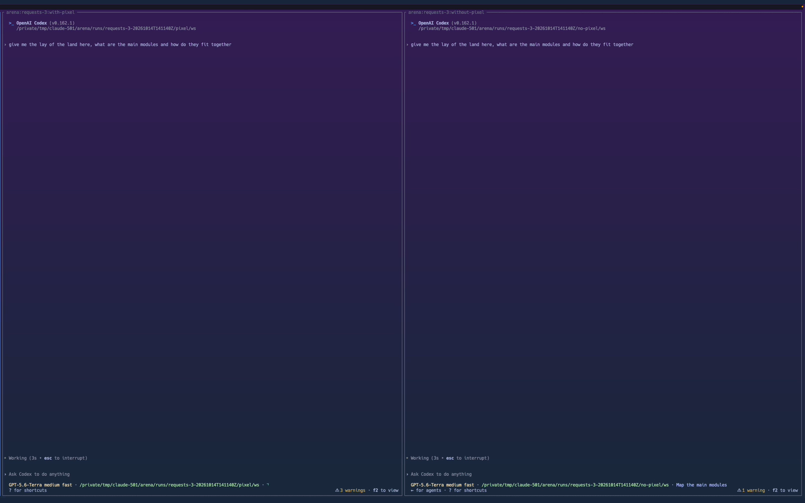
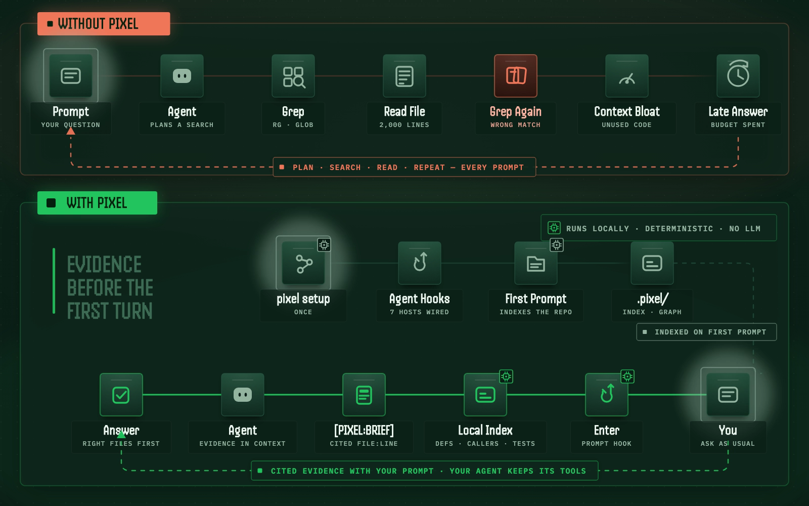
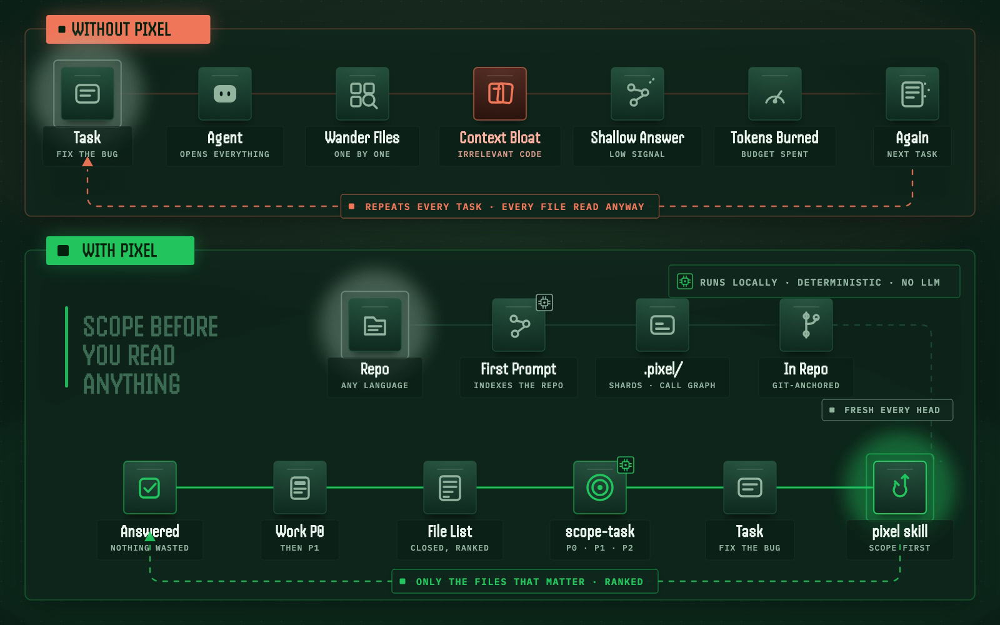

<h1 align="center">🟩 Pixel</h1>

<p align="center">
  <strong>Your agent stops grepping. It starts answering.</strong><br/>
  Source-cited repo context, injected the moment you hit <kbd>Enter</kbd>.
</p>

<p align="center">
  <a href="https://github.com/Pixel-CLI/pixel/releases/latest"></a>
  <a href="https://github.com/Pixel-CLI/pixel/actions/workflows/ci.yml"></a>
  <a href="https://www.bestpractices.dev/projects/15211"></a>
  <a href="https://www.bestpractices.dev/projects/15211"></a>
  <a href=".github/SECURITY.md#verifying-a-release"></a>
  <a href="https://github.com/Pixel-CLI/pixel/releases/latest"></a>
  <a href="LICENSE"></a>
</p>

<p align="center">
  <a href="https://pixel-cli.dev/"><b>Website</b></a> ·
  <a href="https://pixel-cli.dev/docs/"><b>Docs</b></a> ·
  <a href="https://pixel-cli.dev/benchmarks/"><b>Benchmarks</b></a>
</p>

<p align="center">
  
</p>

<p align="center"><sub>Same question, same repo, same Codex. <b>36 s</b> with Pixel. <b>1 min 58 s</b> without. One recorded run, sped up uniformly — <a href="docs/motion/prompt-submit/README.md">source and limits</a>.</sub></p>

---

## ⚡ Install

```bash
curl -fsSL https://github.com/Pixel-CLI/pixel/releases/latest/download/install.sh | sh
pixel setup              # pick your agents
```

Restart your agent, approve hooks if asked, ask your next code question. That's it: Pixel indexes the repository on its first use. Want it warm up front? `pixel prepare-repo .`

<sub>[Read the installer](scripts/release/install.sh) · [release notes](https://github.com/Pixel-CLI/pixel/releases/latest) · [build from main](.github/CONTRIBUTING.md#build) for unreleased integrations.</sub>

## 🧠 The problem

Your agent burns its first turns on **discovery**: plan a grep → run it → read a 2,000-line file → grep again → repeat.
You pay for every loop. In tokens. In wall time. In context it never uses.

## 🟩 The fix

Pixel hooks your agent's prompt-submit event. Before the model sees your question, Pixel queries a **local code index** and attaches a compact `[PIXEL:BRIEF]`: definitions, callers, code, tests and git history, cited `file:line`.

<p align="center">
  
</p>

The agent starts with the evidence already in context. It keeps all its tools — it just doesn't have to go hunting.

```bash
pixel brief "Where is request validation implemented?" .   # see what your agent gets
pixel doctor .                                              # check install and index health
export PIXEL_BRIEF=0                                        # turn briefs off
```

## 🛠️ Retrieval on demand: the Pixel skill

Need more than the brief? `pixel setup` drops a `pixel` skill into each agent's `skills/` folder. The agent asks the index directly — one call, then a targeted read:

| Agent asks | Pixel answers with |
|---|---|
| where is X defined? | `pixel find-symbol 'X'` |
| who calls X? | `pixel who-calls '<uid>'` |
| what breaks if I change X? | `pixel impact '<uid>' --depth 1` |
| outline of this 2,000-line file? | `pixel list-signatures <file>` — **median −94.5%** read volume |
| just this one function | `pixel pack-context '<uid>' --budget 1500` |

<p align="center">
  
</p>

<sub>Both animations illustrate a workflow; they are not timed agent comparisons. [Agent trials and their limits](https://pixel-cli.dev/benchmarks/#on-whole-agent-tasks).</sub>

## 📊 Numbers

| | without Pixel | with Pixel |
|---|---|---|
| Same Codex question on Requests (one recorded run) | 1 min 58 s | **36 s** |
| Requests `models.py`: full read vs. outline | 10,365 tokens* | **641 tokens*** (−94%) |
| 8 large open-source files: full read vs. outline | 100% | **median 5.5%** (−94.5%) |

<sub>*Estimated tokens (bytes ÷ 4), Pixel 0.5.x, no billed cost. Every number has a protocol, and we publish the losses too: [benchmarks](https://pixel-cli.dev/benchmarks/).</sub>

## 🆚 Alternatives

Keeping the agent's context bill down is an idea whose time has come — teams at AWS and Spotify ship their own takes on it:

| | What it does | Mechanism | Cost model |
|---|---|---|---|
| **Pixel** | Attaches cited repo context (`file:line` brief: definitions, callers, tests, git history) before the model sees your prompt | Local code graph + prompt-submit hook | Deterministic index lookup — no model call, no latency, free |
| [AWS AgentCore Memory sample](https://github.com/aws-samples/anthropic-on-aws/tree/main/agent-sdk-agentcore-memory) | Wraps every `query()`: fetches short-term history and long-term summaries before the call, saves turns after | Claude Agent SDK + managed AgentCore Memory | Managed AWS service; LLM-extracted cross-session memory, not code structure |
| [Spotify `shunt`](https://github.com/spotify/portal-ai-plugins/tree/main/plugins/shunt) | Hooks block the agent from reading large files directly; a skill delegates the read to a cheaper internal LLM that summarizes (82–94% token savings claimed) | Claude Code `PreToolUse` hooks → AiKA modes via Portal CLI | An extra billed model call per delegated read or codegen |

Same goal, different lever: those delegate work to another model or service, Pixel makes the context a **deterministic lookup in a local index**. No extra tokens, no extra round trip, no cloud dependency — the same brief every time, cited to the line.

## 🔌 Works with

**Claude Code · Codex · pi · Devin · OpenCode · Gemini CLI · Antigravity**

One `pixel setup` wires each host's hooks or extension.

## 🔒 Local. Free. Yours.

- 🦀 Single Rust binary · macOS (Apple Silicon) and Linux
- 🏠 Indexing and lookup run **on your machine** — no account, no API key, [no telemetry](.github/SECURITY.md)
- 📜 MIT licensed · see [NOTICE](NOTICE) for attribution

## 🎯 Bonus: `pixel classify`

Typed decisions from a local model — routing, gating, triage — one probability per label:

```bash
pixel classify "Review this Rust PR, find correctness bugs, and propose a safe patch." \
  --engine ollaya \
  --context "Choose the cheapest model that can reliably handle the request." \
  --label 'claude-haiku-4.5_(fast)' \
  --label 'claude-opus-5.5_(strong)' \
  --label 'claude-fable-5.1_(reasoning)' \
  --criterion 'claude-haiku-4.5_(fast)=Simple rewriting, extraction, or classification; no deep reasoning.' \
  --criterion 'claude-opus-5.5_(strong)=Complex coding, multi-file review, or tool use; accuracy matters.' \
  --criterion 'claude-fable-5.1_(reasoning)=Multi-step analysis, difficult debugging, or high uncertainty.'

claude-fable-5.1_(reasoning): 0.192
claude-haiku-4.5_(fast): 0.098
claude-opus-5.5_(strong): 0.710
predicted: claude-opus-5.5_(strong)
```

Runs locally with Ollaya, or remote through OpenRouter, Ollama, DeepSeek, OpenCode Go, OpenAI or any OpenAI-compatible endpoint. [Model bake-off →](docs/bench/decide-bakeoff.md)

---

<p align="center">
  <a href="https://pixel-cli.dev/docs/">Docs</a> ·
  <a href="docs/manual-setup.md">Manual setup</a> ·
  <a href="https://pixel-cli.dev/benchmarks/">Benchmarks</a> ·
  <a href="docs/github-actions.md">GitHub Actions</a> ·
  <a href="ARCHITECTURE.md">Architecture</a> ·
  <a href=".github/CONTRIBUTING.md">Contributing</a> ·
  <a href=".github/SECURITY.md">Security</a> ·
  <a href="https://github.com/Pixel-CLI/pixel/issues/new?template=bug_report.yml">Report a bug</a>
</p>
